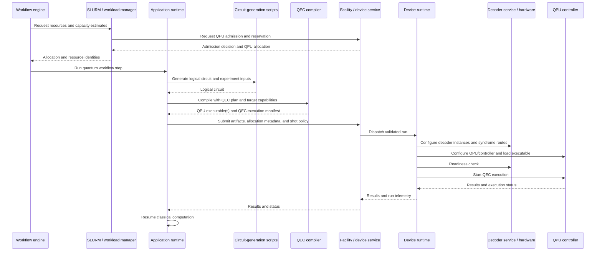
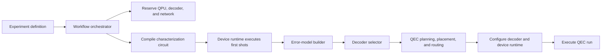

# QEC Workflow Actor Analysis

This analysis develops candidate software responsibilities and workflows for QEC execution. The October 19 and October 21, 2026 meeting discussions are inputs to this analysis, rather than specifications or complete statements of requirements. The intended outcome is an architecture that is technically sound, practical for target hardware, and supports substitutable implementations. This document is intended to guide later sequence and component diagrams; it does not prescribe a specific implementation or replace the current Q-IRIS implementation.

## Architectural boundary

The workflow has two distinct operating regions:

- A **control plane** prepares, provisions, starts, observes, and closes a QEC run.
- A **real-time data plane** carries syndrome data and feedback during the run.

For hardware with microsecond-scale feedback requirements, the orchestration layer cannot intervene for each syndrome packet. Before execution begins, the control plane must establish the decoder assignments, data routes, and feedback mechanism. During execution, the QPU/control system, transport, decoder, and feedback actuator communicate directly.

## Candidate end-to-end flow

The following sequence is a proposed division of responsibility. Specific target platforms may combine, omit, or move steps once their capabilities and control interfaces are known.



### Persistent platform configuration

The platform should establish stable capabilities outside a particular workflow run:

- QPU controller firmware and device interface.
- Available decoder implementations or FPGA images.
- Base network connectivity.
- Hardware topology and device capability descriptions.
- Authentication and access to the QRI or device service.

### Run-specific QEC configuration

After allocation, the device runtime configures state that belongs to the particular run:

- QPU program and timing schedule.
- Selected decoder algorithm and error model.
- Decoder-instance assignment.
- Syndrome measurement-to-decoder mapping.
- Network endpoints and routes.
- Feedback method, such as a Pauli-frame update, controller branch, or later circuit segment.

This separation permits persistent decoder infrastructure while retaining run-specific placement and routing decisions.

## Hybrid application and facility workflow

A QEC workflow may be invoked from a mixed classical–quantum application rather than from a single, standalone circuit. An application runtime identifies or receives a quantum region, prepares its input circuit and shot request, submits the quantum work, receives results, and resumes the surrounding classical computation. A program can therefore contain multiple quantum regions and may make later quantum work depend on earlier results.

CCAM is one example of a programming model that could follow this pattern. The QEC workflow architecture must support that model without making CCAM a required application interface. The application-facing input may instead be a workflow specification, a higher-level language, OpenQASM, or another circuit source.

### Facility admission and changing quantum demand

Before a job starts, the workflow engine supplies resource requirements to the workload manager. In a Pathfinder-like facility, Slurm and a QPU resource manager such as QPMD may jointly admit the job and reserve its classical and quantum resources. Relevant estimates include circuit count, maximum depth, expected shot count, QPU time, decoder capacity, accelerator capacity, and network requirements.

Adaptive shot selection and repeated quantum regions make those estimates uncertain. The application runtime may submit an initial shot batch, evaluate whether a quality target is met, and request additional shots. The architecture therefore needs a policy for one of the following approaches:

- Reserve a declared upper bound for adaptive execution.
- Require the runtime to report revised estimates to the resource manager.
- Use fixed shot counts for an initial integration path.

The appropriate policy depends on facility scheduling capabilities and the target experiment. It remains an architecture decision rather than an assumed QEC workflow behavior.

### Client, facility-service, and device boundaries

The QEC workflow needs an explicit submission boundary between the application-side runtime and a facility or device service. A service may perform admission control, payload validation, device-specific translation, status reporting, and delivery to QRMI, QDMI, or another device interface. A QRI-style interface can provide topology, gate capabilities, calibration, and other device metadata to the components that need it.

The following allocation is a candidate, not a settled design:

| Boundary | Candidate responsibility |
| --- | --- |
| Application runtime to facility service | Submit reservation metadata, a circuit or compiled package, shot policy, credentials, and result requirements. |
| Facility service | Coordinate admission and facility policy; validate the payload; select or invoke the device-facing path; return identifiers, status, and results. |
| Compiler to device runtime | Provide the QPU executable and QEC execution manifest, including mapping, syndrome, timing, and decoder-binding requirements. |
| Device runtime to controller and decoder | Apply the run-specific configuration and start execution. |

The client-service payload may be a source circuit, a common exchange representation, or an already device-ready package. The final design must define when translation is allowed and preserve a device-ready payload without unintended retranspilation.

### Timing domains

Timing requirements must be shown on the diagrams rather than treated as one system-wide latency value.

| Timing domain | Examples | Primary owner |
| --- | --- | --- |
| Application and workflow | Classical processing between quantum regions; experiment-level iteration | Application runtime and workflow engine |
| Admission and scheduling | Resource estimation, reservation, queueing, and allocation | Workload manager and facility resource manager |
| Compilation and setup | Mapping, compilation, package preparation, decoder deployment, and route installation | Compiler, planner, and device runtime |
| QEC execution | Syndrome rounds, decoder processing, and feedback | QPU controller, transport, decoder, and feedback actuator |
| Hardware control | Pulse schedules, gate and readout timing, and device operations | Device runtime and QPU control stack |

Tight QEC deadlines begin in the lower execution and hardware-control domains. The diagrams should identify the required deadline, the data path subject to it, and the component that guarantees it.

### Physical-qubit and patch mapping

Logical patch definition and physical-qubit assignment are separate decisions:

| Component | Responsibility |
| --- | --- |
| QEC planner | Defines logical patches: code, distance, count, and logical layout. |
| Scheduler / device runtime | Supplies the available QPU allocation, topology, current constraints, and calibration references. |
| Compiler / mapper | Assigns each logical patch to concrete physical qubits and emits the circuit schedule, measurement identities, and decoder-binding requirements. |
| Device runtime | Validates that the compiled assignment is still available and usable, then configures the QPU and QEC compute elements from it. |

The compiler owns the definitive physical mapping because it affects gate decomposition, routing, syndrome measurement, timing, and the decoder's interpretation of measurements. Selecting physical qubits only after compilation could invalidate the compiled program.

The expected order is therefore:

```text
Reserve QPU resources
-> obtain allocated topology and constraints
-> compile and map logical patches to physical qubits
-> device runtime configures and launches the compiled program
```

When a compiled artifact already exists, the device runtime may select a compatible mapping included in that artifact or request recompilation if the allocated resources differ.

## QEC compilation and decoder binding

QEC compilation should consume an explicit QEC plan. The compiler should not independently select the code family, code distance, or decoder policy.

| Stage | Responsibility |
| --- | --- |
| Experiment / QEC planner | Selects the code, distance, logical layout, desired decoder properties, and feedback model. |
| Compiler | Lowers a logical circuit into an encoded physical program: encoding, syndrome-extraction cycles, logical-gate realization, physical mapping, scheduling, measurement labels, and feedback hooks. |
| Device runtime | Binds the compiled program to allocated QPU and decoder resources, routes, and execution endpoints. |

For a memory experiment, the compiler may produce state preparation, repeated syndrome-extraction rounds, final readout, and the measurement metadata needed for decoding. More general fault-tolerant computation additionally requires implementation of logical operations for the chosen code and target hardware.

Decoder location should normally be late-bound. The compiler emits a decoder-binding requirement that identifies the syndrome stream, logical patch, schema, timing, required decoder capability, and feedback interface. After resource allocation, the scheduler and device runtime select concrete decoder resources and configure endpoints and routes. Some tightly integrated targets may require a hardware route or endpoint identifier in the QPU executable; in that case a final binding or packaging step can insert it without making the logical compiler output depend on a fixed decoder host or network address.

The compiled output will often be a package rather than a single binary:

- QPU/controller executable or pulse/control program.
- Optional decoder executable, FPGA bitstream selection, or decoder model reference.
- QEC execution manifest.
- Physical-qubit and logical-patch mapping.
- Syndrome schema and measurement identities.
- Schedule and timing constraints.
- Decoder requirements and feedback contract.
- Calibration/error-model version and provenance identifiers.

The device runtime uses the manifest and the resource allocation together to configure the QPU and QEC compute elements.

## Logical actors and responsibilities

| Component / actor | Responsibility |
| --- | --- |
| Experiment definition | Defines the workload, QEC code, target metrics, shot budget, and latency requirements. |
| Workflow orchestrator | Owns the run lifecycle, including phases, dependencies, retries, and collection of outputs. |
| Resource broker / scheduler | Reserves QPU, classical hosts, accelerators, FPGA decoder capacity, and network resources. |
| Facility resource manager | Performs QPU admission control and coordinates quantum capacity with the workload manager; QPMD is a candidate implementation in the Pathfinder environment. |
| QEC planning service | Translates experiment goals and hardware constraints into a QEC plan: code distance, patches, decoder requirements, and feedback mode. |
| Characterization service | Executes the initial compiled shots and obtains calibration, readout, and error information for the chosen qubits and circuit. |
| Error-model builder | Converts calibration and first-shot data into a versioned decoder-ready device error model. |
| Decoder selector | Chooses a decoder implementation and its parameters from the code, error model, resource availability, and latency target. |
| Decoder configurator / deployer | Starts decoder instances, supplies code and mapping metadata, allocates patches, and verifies readiness. |
| Placement and route planner | Maps logical patches and measurements to physical qubits, decoder instances, endpoints, and syndrome packet routes. |
| Compiler | Produces a physical circuit, timing and schedule metadata, measurement identities, and feedback hooks. The compiler remains stateless. |
| Application runtime | Identifies or receives quantum regions, submits compilation and execution requests, incorporates results, and resumes surrounding classical computation. |
| Device runtime | Configures the QPU/control stack from the compiled mapping, installs schedules and routes, validates readiness, and starts or stops the physical run. |
| QRI / device adapter | Isolates clients from QRMI, QDMI, and simulator-specific APIs. |
| Facility / device service | Validates submitted work, applies facility policy, manages status and results, and invokes the selected device-facing path. |
| Syndrome extraction / ingress | Converts measurement records into the decoder's expected syndrome stream when the QPU does not already produce it. |
| Decoder data plane | Carries syndrome data directly to assigned decoder instances and returns corrections or logical-state estimates. |
| Feedback actuator | Applies a decoder result through a Pauli-frame update, controller branch, pulse/control instruction, or later compiled segment. |
| Results and metrics service | Stores raw and decoded results and computes logical-error metrics, timing, and resource consumption. |
| Provenance / observability | Records versions of the circuit, calibration, error model, decoder, mappings, routes, and run telemetry so results are reproducible. |

## Missing responsibilities identified

The initial list of resource reservation, application runtime, compiler, device runtime, decoder selection, and decoder configuration omits several responsibilities needed to make decoder orchestration concrete:

- Error-model construction from calibration and initial-shot data.
- QEC planning, including code, patch, and feedback-mode decisions.
- Placement of code patches and decoder instances.
- Provisioning of syndrome-data routes before the run starts.
- Syndrome extraction when raw measurement output is not already decoder-ready.
- Applying decoder outputs through an explicit feedback mechanism.
- Capturing metrics and provenance needed to assess and reproduce a QEC result.
- Admission-control handling for changing shot demand and repeated quantum regions.
- A defined client-to-facility-service payload boundary, including rules for translating or passing through device-ready artifacts.
- Explicit timing ownership from application iteration through pulse-level device control.

## Initial-shot characterization phase

The first-shot activity should be an explicit workflow phase. It produces the run-specific information needed to select and configure the decoder, including effects of hardware drift for the circuit and physical qubits of interest.



This may require an iterative preparation path:

```text
Initial QEC plan -> preliminary compilation and placement
-> characterization shots -> error-model construction
-> decoder selection/configuration -> final QEC compile/package
-> device setup and execution
```

Some targets may reuse the preliminary compiled circuit after decoder selection. Others require final recompilation when decoder choice changes timing, feedback behavior, syndrome layout, or physical placement.

## Proposed sequence diagrams

The initial diagram set should contain three sequence diagrams.

### 1. Characterization and QEC setup

Show reservation, compilation, first-shot execution, error-model construction, decoder selection, decoder deployment, route provisioning, and readiness checks.

### 2. Real-time QEC execution

Show the device runtime starting the run, followed by the fast execution path:

```text
QPU/controller -> syndrome ingress/transport -> decoder -> feedback actuator/QPU controller
```

The workflow orchestrator should observe status without processing each syndrome packet.

### 3. Completion and analysis

Show run closure, result collection, decoding or aggregation where required, calculation of logical error rate, lifetime/fidelity, decoder latency, and resource use, and persistence of provenance.

## Component diagram scope

The component diagram should distinguish the following regions.

### Control plane

Experiment definition, workflow orchestration, reservation, QEC planning, characterization and error-model construction, compilation, decoder selection and configuration, placement and routing, and device setup.

### Execution data plane

QPU/controller, syndrome extraction, transport route, decoder instances, and feedback actuator.

Q-IRIS can be shown as a current implementation that spans several logical components, likely including workflow orchestration, task execution, and result handling. It should not be the only architectural boundary: the logical components need interfaces that allow alternative compilers, runtimes, decoders, and execution services to be substituted.
