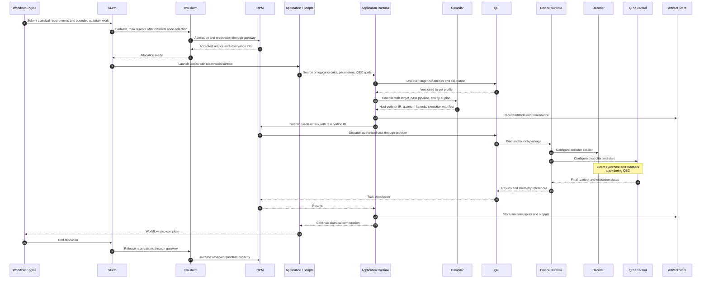

# 00. End-to-end operation and data flow

This is the coarse hybrid workflow. Scripts start on classical resources only after allocation succeeds. The application runtime coordinates compilation and quantum submissions; the resource owns the QEC execution path. Pilot runs and decoder setup are expanded later. Solid arrows carry requests or data; dashed arrows carry responses. Every arrow is a logical interface, not a requirement for a separate network hop.

## Open questions

- **Boundary:** Is the first exemplar a single hybrid allocation, or staged preprocessing, quantum execution, and postprocessing allocations? A quantum stage still needs a classical client process.
- **Interface:** Which execution-package format can pass from the runtime to the provider without unintended recompilation?
- **Ownership:** Which QEC setup functions already exist in the selected device runtime, and which require extensions?
- **Outcome:** Is the first claim successful integration, a bounded feedback latency, or a measured logical-error improvement? Each requires different evidence.

Actor definitions and source status are in the [README](README.md).
