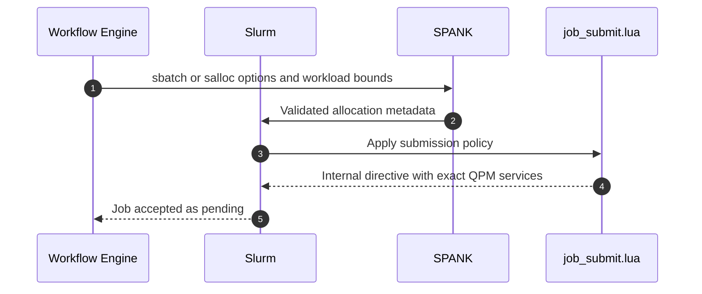
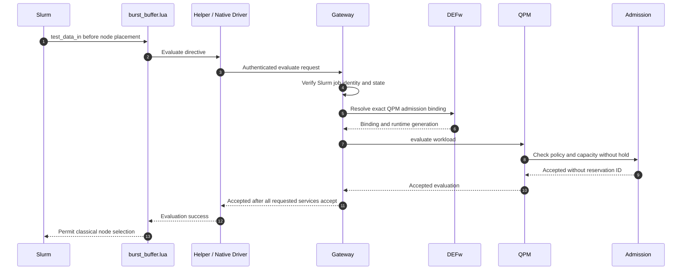
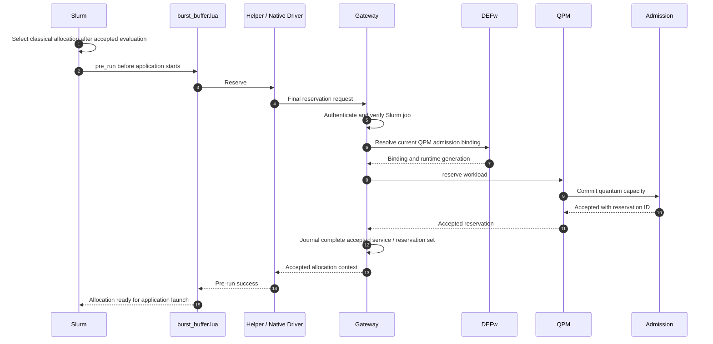
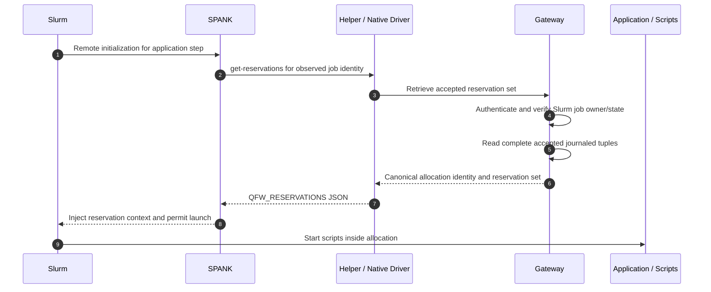
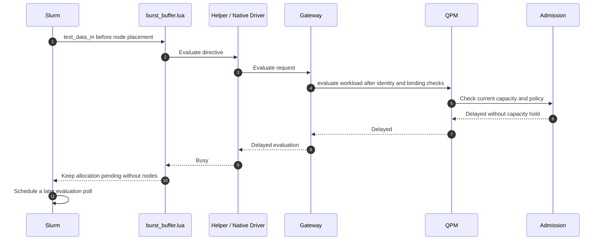
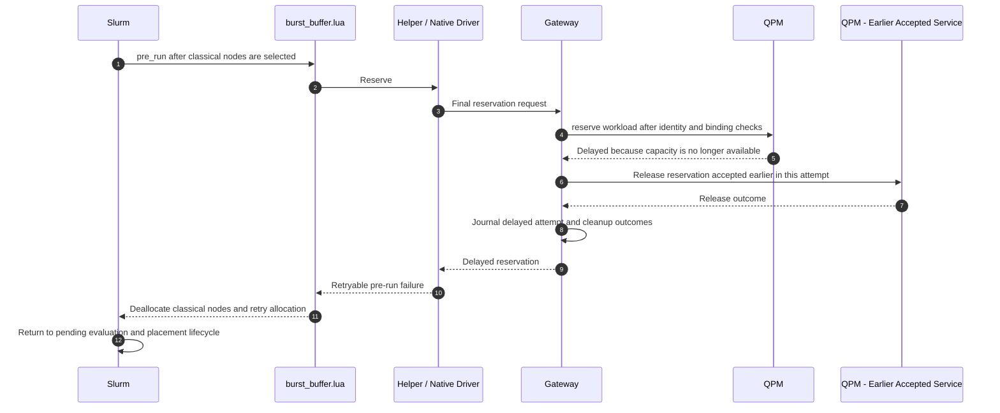
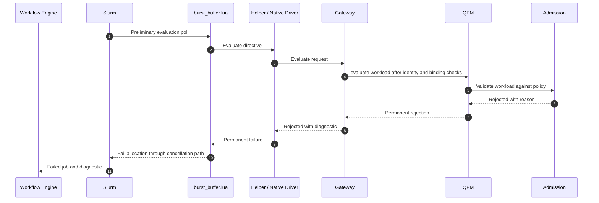

# 01. Allocation, reservation, and admission control

These sequences follow the detailed qfw-slurm documents. Each diagram shows one phase or outcome so the reader can follow it without nested loops or alternatives. The Slurm plugin path reaches admission through the native driver, gateway, and QPM. Preliminary `evaluate` neither holds capacity nor returns a reservation ID. Slurm selects classical nodes before `pre_run` commits the quantum reservation. This is optimistic coordination, not an atomic distributed reservation.

## 1. Submit the allocation

The workflow engine submits quantum workload bounds alongside the classical resource request. Allocator SPANK validates the options, and the job-submit policy maps public QPU names to exact QPM service IDs. No remote admission call occurs in this phase.

The user-facing bounds include `--circ-count`, `--max-qubits`, `--max-depth`, and `--max-shots`, with optional gate and measurement bounds. QPU selection and workload kind are also required.

### Open questions

- **Estimation:** Do bounds refer to logical input circuits or expanded physical tasks? The runtime must reconcile its generated work with the admission representation.
- **Capacity:** Are decoder boards permanently attached to each QPU, or must Slurm/QPM jointly reserve decoder instances, GPU capacity, and transport? Current QPU bounds do not establish that capability.

## 2. Preliminary quantum evaluation succeeds

This diagram shows one successful evaluation of one requested QPM service. The gateway performs the corresponding evaluation for every requested service; all must accept before node placement proceeds. Slurm owns evaluation polling. The gateway authenticates the request, verifies the Slurm job, and resolves the current QPM binding.

### Open questions

- **Capacity:** Which QEC resource constraints can admission evaluate beyond the QPU workload bounds?
- **Diagnostics:** Can a delayed decision distinguish QPU capacity, decoder capacity, and service unavailability so the workflow engine can explain the wait?

## 3. Classical placement and final reservation succeed

After accepted preliminary evaluation, Slurm selects the classical allocation under its normal scheduling policy. If nodes are unavailable, the job remains pending without a final QPM reservation. Once nodes are selected, `pre_run` commits quantum capacity before any application starts. The diagram shows one QPM interaction; the gateway reserves all requested services and journals the complete accepted set before returning success.

### Open questions

- **Binding:** How does the accepted reservation cover the concrete decoder/control resources needed by a QEC task?
- **Adaptation:** Can allowance be changed after admission? `renew` is documented for reservation lifetime; it must not be assumed to enlarge circuit/shot allowance.
- **Dynamic resource estimation:** As execution reveals that a job needs more or fewer resources, which component updates the estimate of remaining demand, and how is that information communicated to QPMd admission control? How should admission use those updates to revise capacity forecasts, reclaim unused allowance, or evaluate additional capacity requests while maintaining QoS across jobs? Updated estimates must be distinguished from authorized changes to the reservation.

## 4. Pass the accepted reservation to an application step

Remote SPANK retrieves the accepted reservation set from the gateway journal before the application process starts. This is a lookup, not another admission or reservation operation. Every step in the allocation reuses the accepted set. `srun` does not create, extend, or release QPM reservations.

### Open questions

- **Identity:** How does the accepted reservation bind a QEC package to a decoder/control session and prevent cross-job stream mixing?
- **Multiple resources:** How does the application runtime select the intended service when the accepted set contains several QPMs?

## 5. Preliminary evaluation is delayed

This is one delayed evaluation poll. Slurm keeps the allocation pending and retries through its normal lifecycle. Neither classical nodes nor quantum capacity are held. A permanent rejection takes the separate failure path in section 7.

### Open questions

- **Policy:** Which delay reasons and retry guidance are available to Slurm and the workflow engine?
- **Visibility:** How should users distinguish waiting for quantum admission from waiting for classical placement?

## 6. Final reservation is delayed after classical placement

Capacity may change between preliminary evaluation and final reservation. If final reservation delays, the gateway requests release of any reservations accepted earlier in that attempt. Slurm deallocates the selected classical nodes and retries the whole allocation. For a single requested QPM with no accepted reservation, there is no partial reservation to release. The diagram illustrates the multi-QPM case with an earlier accepted service.

### Open questions

- **Recovery:** Who reconciles a partial reservation whose release cannot be proven terminal? The gateway must preserve that outcome rather than assume capacity was freed.
- **Generation:** How are unavailable or restarted QPM services handled between evaluation, reservation, and rollback?

## 7. Admission permanently rejects the request

A permanent rejection fails the allocation rather than keeping it pending. This diagram shows rejection during preliminary evaluation, when there are no assigned classical nodes or committed quantum reservations. A rejection during final reservation requires the rollback from section 6, followed by allocation failure instead of retry.

### Open questions

- **Diagnostics:** Which rejection details can the workflow engine expose so a user can revise the request?
- **Policy:** Which conditions are permanent rejection rather than temporary delay, particularly unsupported QEC capabilities or insufficient declared bounds?

Sources: [reservation sequence](../../../../openQSE/QFw-release-v0.1/repos-main-sync/reservation-workflow-sequence.md), [qfw-slurm workflow](../../../../openQSE/QFw-release-v0.1/repos/qfw-slurm/docs/workflow.md).
