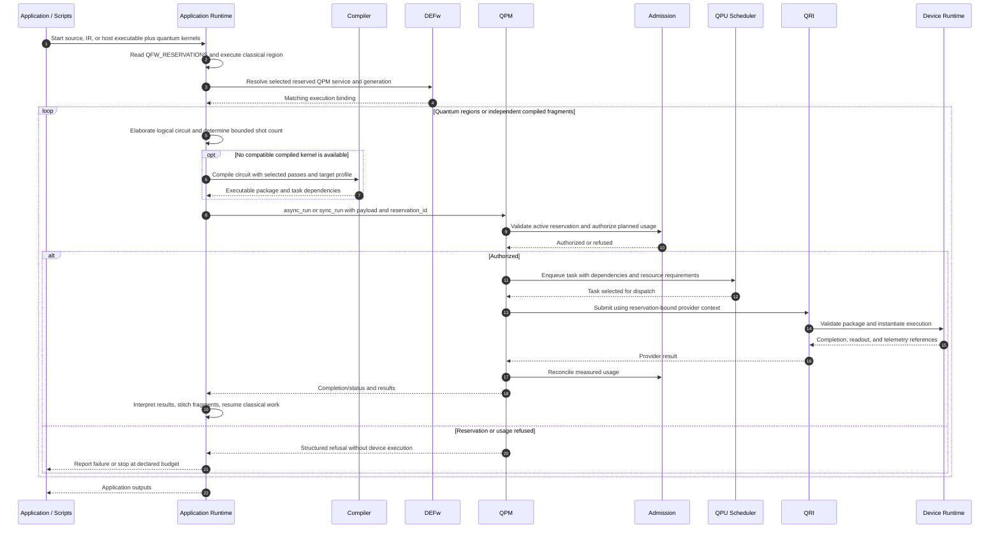

# 02. Application runtime and quantum task submission

After scripts start, the application runtime orchestrates classical regions and quantum tasks. CCAM illustrates an interpreted or elaborated mixed program; another toolchain may produce host binaries and quantum kernels in advance. A single universal mixed binary format is not assumed. In both cases the runtime must preserve classical dependencies and submit quantum work under the existing reservation.

Circuit cutting creates multiple execution tasks and classical reconstruction dependencies. It is a configured compiler transformation plus runtime scheduling/postprocessing; knitting is not automatically a device-side QEC operation. Admission must account for the multiplied work. Submission to the provider remains under the same reservation owner rather than opening an unrelated QRMI/QDMI execution session.

## Open questions

- **Program interface:** Which host/quantum ABI describes region inputs, outputs, blocking behavior, and errors? Is the first implementation CCAM IR, a Python SDK workflow, or compiled host code?
- **Submission data:** Which payload formats are accepted and how does the service distinguish already compiled packages from circuits requiring translation?
- **Task lifetime:** How are cancellation, timeout, lost completion events, and partial fragment results represented without duplicate physical execution?
- **Ownership:** Are fragment dependencies scheduled by the application runtime or QPM? QPM's QPU scheduler owns device dispatch, while the workflow engine owns broader stages.
- **Security:** How are callers authenticated and reservation ownership checked? Provider secrets should be bound by the service rather than placed in compiler artifacts.
- **Results:** Are per-shot ordered measurements available, or only counts? Counts alone cannot reconstruct temporal syndrome streams.

Sources: [running-job sequence](../../../../openQSE/QFw-release-v0.1/repos-main-sync/running-job-workflow-sequence.md), [QPM APIs](../../../../openQSE/QFw-release-v0.1/repos-main-sync/QFw/docs/qpmd-supported-apis.md), [CCAM discussion](../rust-infra.md).
