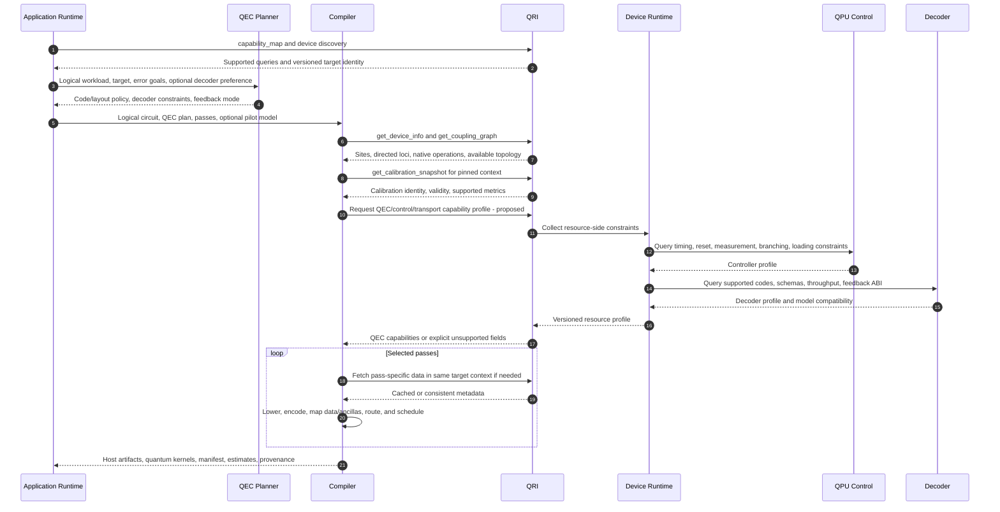

# 03. Compilation, passes, and QRI discovery

The application runtime configures the compiler pipeline. Individual passes may query QRI, but all passes should use a consistent target/calibration context for a compilation. The existing QPM telemetry methods provide quantum metadata; the QEC/control/transport profile below is a proposed extension informed by the Backline notes. Classical decoder capabilities matter when they constrain the physical circuit or feedback contract.

| Information | Compilation use | Expected source/status |
| --- | --- | --- |
| Physical sites, couplings, native gates and supported loci | Data/ancilla placement, decomposition, routing | Existing QRI/QPM discovery; per-provider coverage varies. |
| Gate/readout quality, coherence, calibration identity and validity | Noise-aware mapping, model construction, acceptance limits | Existing calibration records, with provider-specific completeness. |
| Gate/readout/reset durations, alignment, concurrent-operation conflicts | Physical scheduling and cycle duration | Target metadata where available; common timing schema needs confirmation. |
| Mid-circuit measurement, reset, conditional operations, measurement ordering | Feasibility of repeated syndrome rounds and feedback | Capability profile; verify on actual backend. |
| Supported codes, decoder input/output schema, leakage handling, model format | Detector definitions and decoder-compatible QEC program | Proposed decoder profile. |
| Decoder throughput, tail latency, window sizes, number of instances | Decide feasible cycle rate, parallelism, and feedback barriers | Proposed resource-side classical capability profile. |
| Controller memory, parameter updates, code loading, safe segment boundaries | Precompiled branches, segmentation, and possible JIT | Proposed control profile. |
| Transport throughput, worst-case delay, topology class, buffering | Validate direct QEC path and distributed decode feasibility | Proposed profile; concrete links bound at setup. |
| Host CPU/GPU capacity for compilation, simulation, stitching | Host artifact target and application scheduling | Slurm allocation and host runtime, not automatically QRI. |

The manifest should identify code/patch definitions, physical mapping, measurement order, detector construction, logical observables, executable compatibility, feedback interpretation, model versions, and resource requirements. A device noise model describes physical error processes; a detector error model describes their effects on detection events/observables. They are related artifacts, not synonyms.

## Open questions

- **Consistency:** Can discovery provide a snapshot token across topology, calibration, and control capabilities? What does a pass do when only unversioned queries exist?
- **Boundary:** Which lowering is client-side and which is a device backend pass? Final physical mapping must be established before executing the affected kernel.
- **Classical information:** Does QRI describe resource-internal decoder/transport capacity, or only stable capabilities? Dynamic availability and reservation authorization need separate semantics.
- **Decoder coupling:** Which decoder choices alter gate order, reset strategy, leakage measurements, or the feedback ABI, and which change only compatible decoder configuration?
- **Optimization:** Which cutting, encoding, scheduling, and model-building passes are available now? Code and decoder selection may be optimization passes under planner policy.
- **Ports:** Does a target require concrete endpoint relocation into controller instructions? Logical compilation should otherwise require stream IDs and protocol contracts, leaving physical connector/link binding to the device runtime.

Sources: [QPM discovery APIs](../../../../openQSE/QFw-release-v0.1/repos-main-sync/QFw/docs/qpmd-supported-apis.md), [front-end contract](../../../../openQSE/QFw-release-v0.1/repos-main-sync/QFw/docs/design/qpu-frontend-contract.md), [Backline workflow](../../../../openQSE/QFw-release-v0.1/repos-main-sync/backline-workflow.md).
