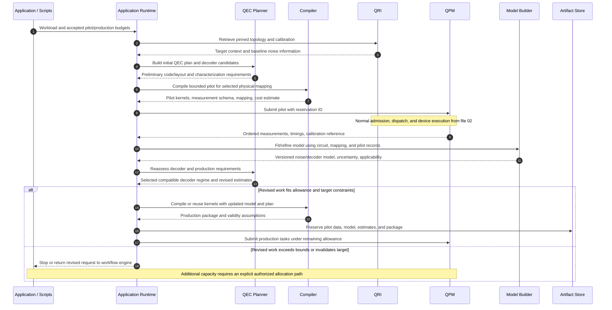

# 04. Pilot runs, resource estimation, and model refinement

Pilot execution is an optional application-runtime policy. A hardware pilot itself needs compiled work and a reservation. Pre-admission estimates can use static analysis, simulation, or earlier measurements; a pilot inside the allocation refines those estimates but does not automatically enlarge the reservation. The same bounded quantum-submission path is used for pilot and production tasks.

A few first shots do not generally identify a full circuit-level error model. The experiment must specify which parameters can be estimated, their uncertainty, and whether the data represent readout errors, gate errors, detector correlations, or workload-level fidelity. If recompilation changes the physical mapping or syndrome schedule, the pilot model must be checked for applicability and characterization may need to repeat.

## Open questions

- **Experiment:** What pilot circuit, shot count, stopping rule, and confidence interval support the desired decoder or mapping decision?
- **Ownership:** Is pilot generation a compiler pass, application library, or runtime module? The runtime owns the repeated execution lifecycle.
- **Data:** Are ordered per-shot/per-round records, leakage flags, and timing available through the provider? Aggregate counts may be insufficient.
- **Model scope:** Does a refined model apply to this mapping, calibration epoch, gate schedule, and code only? Which transformations invalidate it?
- **Resource accounting:** How are pilot shots, failed attempts, cutting fragments, and repeated fits charged against the declared bounds?
- **Adaptation:** If more characterization is needed, can the application stop cleanly and request another allocation? An allowance-update API remains unestablished.

Sources: [characterization workflows](../../../../openQSE/QFw-release-v0.1/repos-main-sync/qhw-characterization/README.md), [hardware data schemas](../../../../openQSE/QFw-release-v0.1/repos-main-sync/qhw-data/README.md), [hybrid runtime discussion](../rust-infra.md).
