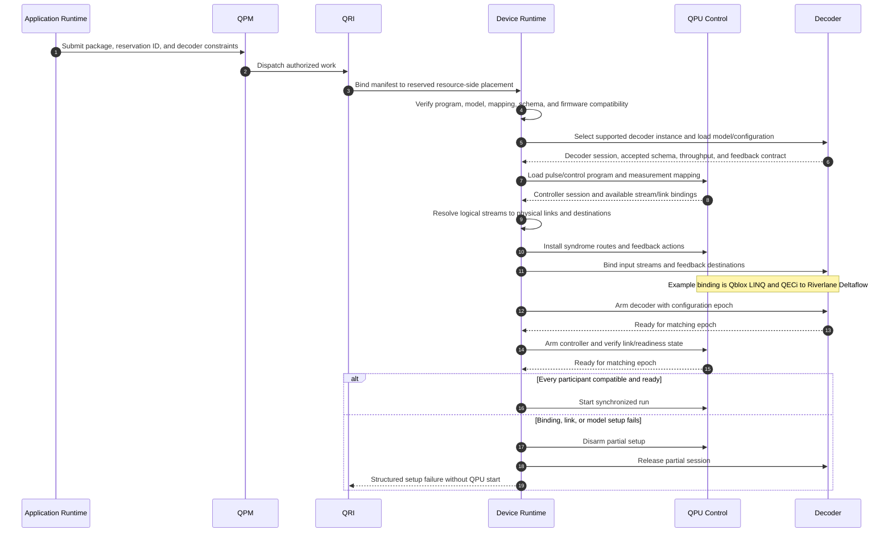

# 05. Configure QEC control, transport, and decoders

The compiler supplies the physical program and semantic requirements. The device runtime binds them to allocated controller and decoder instances. Stable wiring/firmware is provisioned by the facility; per-run configuration establishes measurement identities, decoder models, stream routes, feedback destinations, and a common configuration epoch. The operations below are proposed responsibilities, not verified vendor management SDK calls.

Riverlane describes QECi as defining control-to-QEC data formats, runtime states, and communication parameters. It is distinct from QRI, which is the upper resource interface. The exact QECi messages and management APIs still require the specification and deployed SDK. [Riverlane QECi](https://www.riverlane.com/get-qec-ready/qeci).

Qblox documents LINQ routing by data identifiers between sequencers. That provides a concrete control-fabric example; QRI need not expose every physical connector to the application. [Qblox LINQ documentation](https://docs.qblox.com/en/v2026.10.0/products/architecture/sequencers/linq_based_feedback.html).

| Configuration | Produced by | Applied by |
| --- | --- | --- |
| Code, stabilizers, logical observables, data/ancilla mapping | Planner and compiler | Controller and decoder via device runtime |
| Measurement ordering, detector/parity interpretation, reset conventions | Compiler and model builder | Controller ingress and decoder |
| Decoder algorithm, weights/model, leakage mode, window configuration | Planner/model builder within advertised implementation choices | Decoder management path |
| Controller readout settings and pulse schedule | Target compilation and calibrated control configuration | QPU control |
| Physical connector, lane, stream endpoint, route, and return path | Facility inventory plus runtime binding | Device runtime and control/decoder drivers |
| Feedback meaning, destination, permitted latency, late-result handling | Compiler contract plus platform policy | Controller and frame owner |
| Capture level, sampling, destination, and bandwidth budget | Application policy within facility limits | Runtime and telemetry export |

The runtime must know how the chosen physical link carries data, including the relevant controller port or lane. The compiler normally needs its protocol, capacity, and timing properties. A target-specific final binding pass may insert concrete route identifiers into controller code. A QECi link must not be presumed to be an ordinary IP socket with a TCP/UDP port number.

The control-electronics interface must expose enough information to check the following contracts. Some fields are read-only capabilities; others are authorized configuration or execution operations. They need not all be ordinary application-visible knobs.

| Control contract | Information or operation required |
| --- | --- |
| Measurement production | Measurement IDs/order, discrimination conventions, leakage/soft-information support, reset behavior, and per-shot/round boundaries. |
| Decoder connection | Supported protocol/version, available logical streams and physical links, routing configuration, return-path destinations, and link readiness. |
| Time and synchronization | Clock/alignment domain, acquisition timing, cycle cadence, bounded transport delay, and feedback deadlines. |
| Feedback interpretation | Supported conditional actions, frame update interface, decision identifiers, and late/missing-result behavior. |
| Program lifecycle | Load, validate, arm, synchronized start, stop, drain, reset, and session/configuration-epoch identification. |
| Adaptation and JIT | Supported parameter changes, instruction memory, segment boundaries, and whether code loading can preserve live state within a bound. |
| Observation | Capture capabilities, timestamps, error counters, dropped-record indicators, and bandwidth limits. |

Exposing a capability does not imply the hardware supports it. Unsupported operations must be reported before the compiler or runtime commits to a workflow that requires them.

Choosing an algorithm and choosing CPU/GPU/FPGA placement are separate decisions. Riverlane's product documentation describes its FPGA-based Local Clustering Decoder and supported codes; it does not establish arbitrary user decoder loading or deployment of that implementation on another processor. A compatible software decoder on CPU/GPU is a separate implementation choice whose throughput and deadlines must be evaluated. [Deltaflow 2 product sheet](https://www.riverlane.com/assets/docs/Deltaflow_2_Product_Sheet_Stack_Sep_2025.pdf).

## Open questions

- **Vendor API:** Which Riverlane SDK calls load the code/model, start/reset sessions, bind streams, and report readiness? Which Qblox firmware and host APIs expose the corresponding QECi setup?
- **Physical interface:** Which controller module/connector and decoder connector are present, and what protocol version, link training, synchronization, and cabling are required?
- **Compiler dependency:** Which configuration choices alter the generated instruction stream? Which are compatible model/route updates that need no QPU recompilation?
- **Application policy:** Should the user request a named decoder, an accuracy/latency regime, or both? What explicit error is returned when a preference is unsupported?
- **State:** Who owns the Pauli frame and reset state across shots? How are controller and decoder state cleared without losing epoch alignment?
- **Observability:** Which raw or processed signals can Deltaflow export concurrently, and what overhead or product limitations apply?
- **Safety:** What happens after a missed deadline, packet loss, wrong stream ID, or one-sided restart? How is a partially configured session rolled back?

The local [Backline workflow](../../../../openQSE/QFw-release-v0.1/repos-main-sync/backline-workflow.md) motivates this resource-side binding, but does not demonstrate that these vendor configuration APIs are implemented in QFw.
