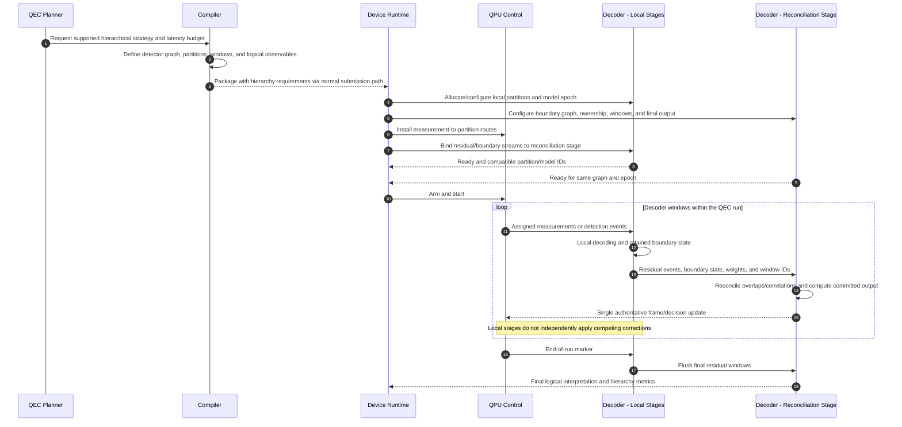

# 07. Configure and run hierarchical decoding

Hierarchical decoding is a candidate design for a decoder that explicitly supports partitioned work, such as local processing with residual/boundary reconciliation. Multiple independent patches alone are parallel decoding, not necessarily hierarchical decoding. The diagram does not claim Riverlane exposes this configuration or that any arbitrary pair of decoders can be composed.

The planner and compiler define the graph/schedule requirements. The device runtime configures a compatible decoder topology and routes. Local and global stages are instances or subcomponents of the shared Decoder actor. Their algorithm must preserve boundary correlations, logical observables, and a single correction/frame authority.

A fast local FPGA stage with a CPU/GPU second stage is plausible only if the algorithm and end-to-end budget support that placement. A slower global stage may be suitable for final interpretation or learning while being unsuitable for an imminent live feedback decision. Logical patch interaction or lattice surgery can change graph connectivity; graph transitions need an explicit supported protocol.

## Open questions

- **Meaning:** Does the target use spatial partitions, temporal windows, concatenated-code levels, or independent patch decoders? These require different semantics.
- **Algorithm:** Which decoder implementation supports composable residual/boundary outputs and proves consistent final correction semantics?
- **Data:** What sufficient information crosses stages: event IDs, parity constraints, weights, soft information, boundary matches, or partial frames?
- **Ownership:** Who partitions the graph, selects overlap/window sizes, and owns unresolved boundaries? Can a backend decoder partition internally instead?
- **Timing:** Which stage commits a decision, how much lookahead is allowed, and what are the worst-case backlogs and deadline failure actions?
- **Reconfiguration:** How are graph/model versions and routes changed when patches merge/split or logical operations alter checks?
- **Hardware:** Can the deployed Riverlane system expose subdecoder stages or external reconciliation at all? If not, treat it as an opaque decoder and evaluate another implementation for this scenario.
- **Failure:** Can one failed partition be retried after measurements have passed, or must the affected shot/run be marked invalid?

This is a proposed extension to the resource-side capability/binding model in the [Backline notes](../../../../openQSE/QFw-release-v0.1/repos-main-sync/backline-workflow.md), not a documented QPM API.
