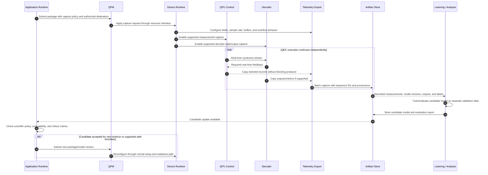

# 08. Syndrome export and learning above the QEC loop

The application can request a capture policy if the resource supports one. A telemetry module copies selected records from control and/or decoder into bounded buffers and transfers them asynchronously to existing workflow storage. Learning consumes those artifacts without becoming part of the feedback deadline. Exporting results is distinct from permitting online model changes.

Useful records include ordered per-shot/per-round measurements, detector definitions, physical/logical mapping, noise-model and decoder versions, frame deltas, final logical outcomes, timestamps, and data-loss counters. Physical error labels are generally unavailable on live hardware; simulated faults, known injected errors, or final logical observables provide different supervision signals. A decoder's own output is not automatically ground truth.

Candidate capture levels are counters only, sampled event streams, full thresholded measurements, and richer soft/readout data where supported. Capture bandwidth and loss policy must be explicit. Best-effort export may drop data and record gaps; a scientifically lossless capture request must be admitted with enough capacity or refused. It must not silently stall live control.

## Open questions

- **Availability:** Can Riverlane export input measurements, internal decoder state, correction outputs, or only summary metrics? Which capture levels can run concurrently with feedback?
- **API:** Does export use QPM result references, a resource-side streaming API, or vendor SDK retrieval? Existing lifecycle telemetry is not evidence of raw syndrome streaming.
- **Data contract:** What schema preserves shot, round, patch, measurement, configuration epoch, and calibration identity across producers?
- **Learning objective:** Are we learning noise parameters, selecting decoders, tuning weights, or changing a decoder algorithm? What validation labels and uncertainty measures are available?
- **Deployment:** Which updates require graph rebuilding, controller recompilation, or only decoder weights? How are version changes synchronized and rolled back?
- **Isolation:** What bandwidth, retention, access permissions, and capture overhead can the facility guarantee?

Sources: [QPM API inventory](../../../../openQSE/QFw-release-v0.1/repos-main-sync/QFw/docs/qpmd-supported-apis.md), [qhw-data records](../../../../openQSE/QFw-release-v0.1/repos-main-sync/qhw-data/README.md). The capture and learning interfaces shown here remain proposals.
