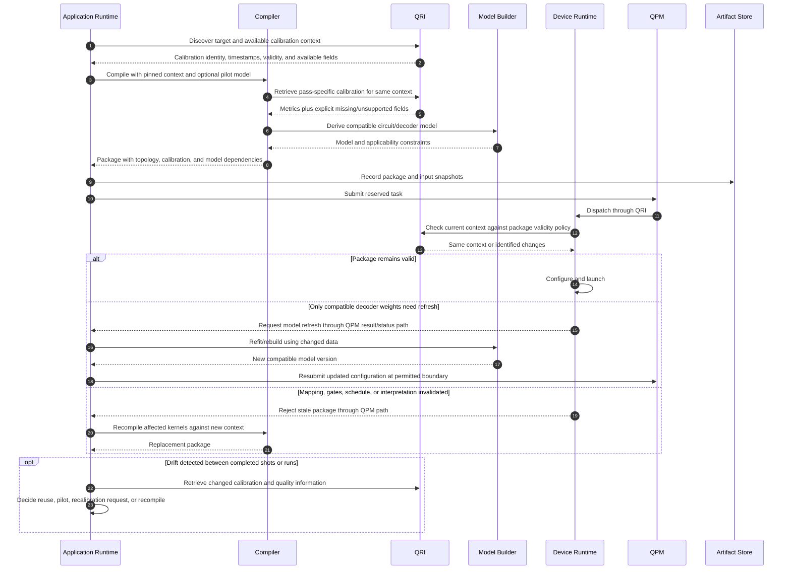

# 09. When calibration is retrieved and what changes afterward

Calibration retrieval is a metadata read. Performing a new calibration is a separate resource-affecting experiment requiring authorization. Reads are useful during initial planning, noise-aware compilation, decoder-model construction, and pre-launch validity checking. Re-reading on every pass or QEC round is unnecessary; passes should share a pinned context and request only missing data.

| Trigger | Why fetch data? | Possible consequence |
| --- | --- | --- |
| Before admission or target selection | Estimate feasibility and costs | Conservative bounds or a different target; later revalidate. |
| After allocation, before physical mapping | Confirm available sites, couplings, and quality | Mapping and schedule selection. |
| During a noise-aware pass | Obtain specific error or duration parameters | Optimization/model changes within one snapshot. |
| After a pilot | Combine circuit-specific observations with baseline metadata | New model with uncertainty and scope; not automatic device recalibration. |
| After queue delay, device maintenance, or failed qubit | Detect invalid compilation assumptions | Accept under policy, rebuild affected artifacts, or refuse execution. |
| Between runs after drift evidence | Determine whether performance degradation has a known cause | More characterization or a facility calibration request. |

## Open questions

- **Versioning:** Can callers request a historical/pinned calibration set, or only the latest one? How are partial/missing metrics represented?
- **Validity:** Who defines expiry and acceptable drift? A changed calibration ID need not invalidate every artifact, while an unchanged ID may not guarantee unchanged hardware.
- **Ownership:** Does the device service validate package assumptions or must the application do so? Who authorizes an actual recalibration experiment?
- **Models:** Which calibration fields support a defensible circuit-level noise model and which require direct characterization?
- **Live operation:** Can controller parameters or decoder weights change safely between shots without losing state alignment? Arbitrary changes during a live quantum state are not assumed.
- **Dependency tracking:** Which transformations depend on which metadata so only affected mapping, pulses, or decoder configurations are rebuilt?

Sources: [telemetry/discovery APIs](../../../../openQSE/QFw-release-v0.1/repos-main-sync/QFw/docs/qpmd-supported-apis.md), [qhw calibration schema](../../../../openQSE/QFw-release-v0.1/repos-main-sync/qhw-data/README.md), [characterization/drift workflows](../../../../openQSE/QFw-release-v0.1/repos-main-sync/qhw-characterization/README.md).
