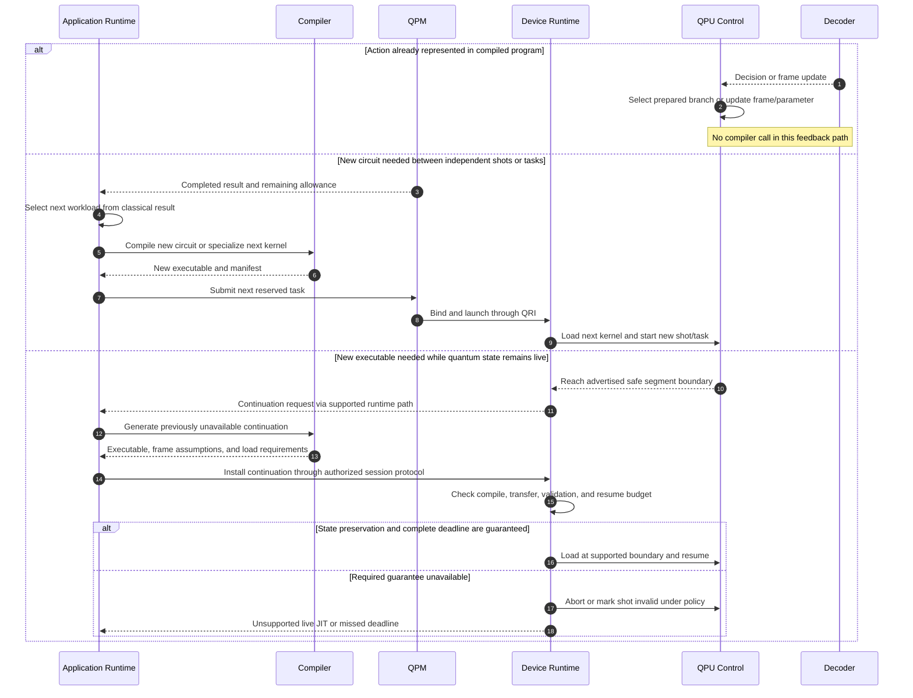

# 10. JIT, prepared feedback, and adaptive execution

JIT means generating executable instructions after runtime information becomes available. It is not required merely because a program contains quantum/classical interaction. Fast decoder feedback can use precompiled conditional actions, frame updates, or supported controller parameters. Host iteration between independent shots can compile a new circuit without preserving a live quantum state.

The CCAM discussion describes elaborating quantum regions during execution and an early FT runtime; it does not establish a hardware guarantee for JIT during a live-state pause. The following sequence distinguishes those cases.

| Scenario | Compilation needed? | Implication |
| --- | --- | --- |
| Measurement chooses a prepared controller branch | No | Needs controller feedback and branch support. |
| Decoder changes a Pauli frame | Usually no | Needs a frame contract and correct later interpretation. |
| Parameter changes within an advertised kernel ABI | No new instructions | Needs supported update timing and bounds. |
| Next shot uses a previously unseen topology/circuit | Possibly | Host compilation is feasible between tasks, subject to reservation bounds. |
| Allocation/calibration invalidates cached mapping | Recompile or finalize before launch | This is target binding/recompilation, not necessarily live JIT. |
| New logical operation schedule needed with qubits live | Possibly | Requires bounded state preservation and continuation/loading semantics; cannot be inferred from a circuit API. |

## Open questions

- **Use case:** Which concrete experiment requires a previously unknown continuation? A first memory experiment may require no JIT at all.
- **Timing:** Can a quantum state survive the worst-case compile, transfer, validate, load, and synchronization delay? Average compiler latency is insufficient.
- **Control interface:** Does the controller support segment boundaries, double buffering, parameter updates, or atomic program replacement? Are those operations usable while state is live?
- **ABI:** How are qubit mapping, clocks, register values, decoder windows, and frame state carried across continuation boundaries?
- **Placement:** Would continuation generation run on the application host or within the resource-side runtime? The latter is not an established capability of this stack.
- **Authorization:** How is continuation usage checked without treating a live-state segment as an unrelated queued task? The proposed session path requires an explicit resource contract.
- **Fallback:** Can finite branches be precompiled within controller memory, or can the scientific experiment be expressed as independent shots instead?

Sources: [CCAM and FT runtime discussion](../rust-infra.md), [Backline resource-side model](../../../../openQSE/QFw-release-v0.1/repos-main-sync/backline-workflow.md). Controller features must be checked against the installed hardware/firmware.
