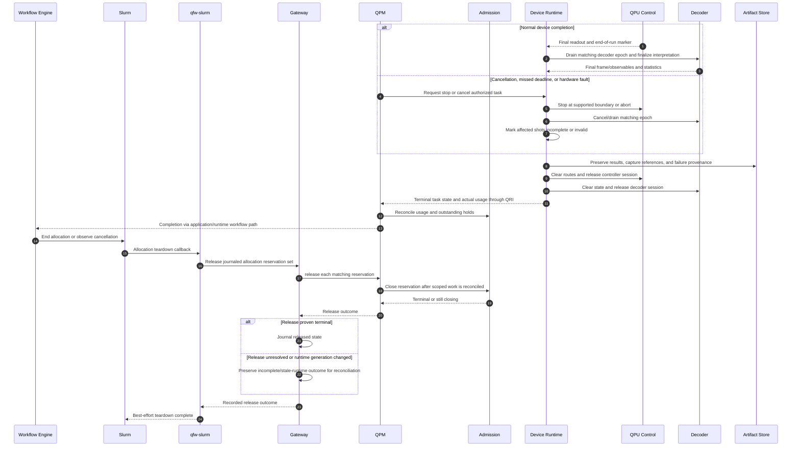

# 11. Completion, cancellation, and resource release

Resource release is part of a complete workflow. QEC session cleanup must stop producers, drain or invalidate outstanding decoder work, preserve final interpretation, and prevent stale state reaching the next job. Slurm allocation teardown then releases QPM reservations through the existing gateway path. Device-session cleanup is a proposed extension; gateway best-effort release and unresolved release recording are documented behavior.

No application retry should blindly repeat an uncertain quantum execution. A lost response may mean the device already ran the shots. Correlation IDs, task handles, and resource-session epochs are needed to determine whether to fetch results, retry setup, or declare an unresolved outcome. Slurm reporting teardown complete does not prove all quantum capacity has been reclaimed.

## Open questions

- **Stop semantics:** Can controller execution be safely interrupted, and which results remain scientifically usable after interruption?
- **Ordering:** What proves no old decoder output can reach a reused controller session? Is an explicit drain acknowledgement available?
- **Accounting:** Are failed setup, partially executed shots, and decoder-only work charged? Who reconciles estimated and actual QEC costs?
- **Recovery:** What persistent identity survives QPM/device-runtime restart? How do we avoid binding a prior reservation to a new service generation?
- **Retention:** Which final frame, raw records, and provenance must be durable before sessions are cleared?
- **Operations:** Who retries unresolved gateway releases and detects leaked decoder/control sessions after a process crash?

Source: [documented allocation release sequence](../../../../openQSE/QFw-release-v0.1/repos-main-sync/release-workflow-sequence.md).
