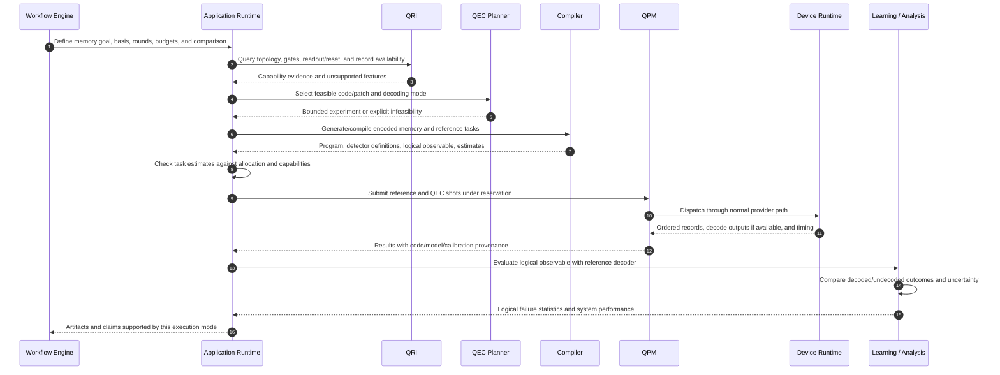

# 12. A useful first demonstration

A supported logical circuit can be FTQC-compiled, but an arbitrary circuit does not automatically produce a feasible or informative demonstration. Code expansion can exceed qubit count or topology; non-Clifford gates may need additional resources and feedback; the backend may lack repeated readout/reset or ordered syndrome output. Successful compilation alone does not establish fault tolerance or improved logical fidelity.

A bounded encoded-memory experiment is a candidate first exemplar. It has a known logical observable, repeated syndrome rounds, and a reference interpretation. Start with a simulator or a verified native patch, then add the real-time decoder path. An offline decode path demonstrates data integration; a hardware loop fed by emulated readout demonstrates control/decoder integration; live-qubit logical performance is a further result requiring suitable hardware and statistics.

The local characterization README already describes a distance-3 memory-style workflow with a 17-qubit footprint and offline decoding. It also states limitations: connectivity checks do not alone guarantee native stabilizer interactions, routing may be permitted, reset must be available, the initial decoder is a simple logical-parity decoder, and `pymatching` detector-graph construction is a future enhancement. That is a useful starting artifact, not evidence of a completed FTQC or real-time decoder pipeline. [Characterization workflow](../../../../openQSE/QFw-release-v0.1/repos-main-sync/qhw-characterization/README.md).

A first result should report the basis, round count, shot count, selected physical layout, calibration/model context, logical observable definition, decoder configuration, uncertainty, and excluded/invalid shots. Systems metrics should include compilation/setup time, actual usage, syndrome throughput, backlog, and full decision-path latency where measured. A break-even or lifetime claim needs an appropriate unencoded reference with stated comparison conditions. A single code distance cannot demonstrate error suppression with increasing distance.

## Open questions

- **Target:** Which simulator or QPU can execute the exact stabilizer schedule and return all required records today?
- **Scientific design:** Which code, logical state/basis, round sweep, and reference answer a specific question? Does a repetition-code experiment suffice for the initial integration goal?
- **Decoder correctness:** Can we construct the detector graph and final-observable mapping for the actual compiled circuit, including routing and resets?
- **Scope:** Is offline decoding acceptable initially, or is bounded real-time feedback the acceptance criterion?
- **Validation:** What known injected faults, noiseless checks, and independent reference decoder establish correct syndrome interpretation before performance claims?
- **Resources:** Does the selected native topology support the patch without excessive routing? Does the shot budget support useful confidence intervals?
- **Next step:** Which extra logical gate or feedback barrier would exercise a capability not demonstrated by memory alone?
