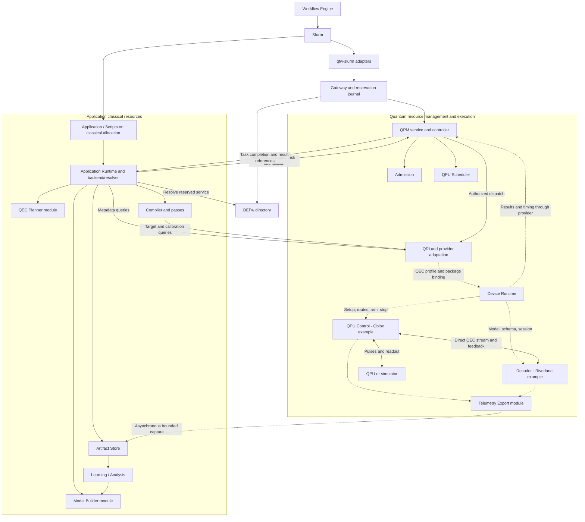

# 13. Component relationships

This component view connects the actors from the sequence diagrams. Solid arrows show established kinds of management/submission relationships; dotted arrows show proposed QEC discovery, configuration, or capture extensions. They do not assert that every solid path has been exercised on a QEC-capable device. Grouping describes responsibility and placement, rather than a required process or deployment count.

QRI can be implemented behind QPM telemetry and provider APIs; drawing it separately makes the interface visible. Admission and the QPU scheduler are QPM-owned modules. The device runtime is a resource-side responsibility that may use Backline/SpaceRT or vendor mechanisms. It does not need to schedule ordinary application nodes. The host application runtime orchestrates quantum regions and experiments; the device runtime coordinates deterministic execution inside the reserved quantum resource.

## Open questions

- **Deployment:** Are QPM and the device runtime colocated, and where do vendor controller/decoder management clients execute?
- **Resource scope:** Is decoder capacity part of the QPU resource's admission profile, a separate QPM resource, or a Slurm-managed accelerator allocation?
- **QRI scope:** How much of control/decoder capability discovery belongs in the common interface versus a versioned provider extension?
- **Modularity:** Which responsibilities can be existing modules within QFw, CCAM, Q-IRIS, or the device runtime? No separate daemon is implied for each actor.
- **Data plane:** Which transport and timing guarantees are enforceable on the actual controller/decoder link, and which asynchronous export path can coexist with them?
- **State:** Where is authoritative frame/configuration-epoch state stored, and how are model, graph, mapping, and route versions kept consistent?

See the [README source map](README.md#source-map) for evidence and the individual sequences for proposed contracts.
